# Network Intrusion Detection using Machine Learning

**Identifying anomalous activity in TCP/IP traffic.** Every network connection in
a simulated US Air Force LAN is classified as **normal** or **anomaly** (attack).
The project compares a logistic regression baseline, a PyTorch neural network
(before and after tuning), a decision tree and a random forest.

[](https://colab.research.google.com/drive/16d_vbC5R4-PEPDZLl6fdbAn80bDaMbS4?usp=sharing)


---

## Why machine learning?

Firewalls and signature-based systems rely on static rules: they block traffic
from known bad IPs or that matches known patterns. A new attack that uses unusual
ports, encrypted payloads or novel behaviour slips through until someone writes a
rule for it. A model trained on connection behaviour (bytes, error rates, how many
connections hit the same service in the last two seconds, and so on) can flag
anomalous traffic it has never seen before.

## Results

All models are scored on the same **5,039 held-out connections** (2,705 normal,
2,334 anomaly). None of these rows was used for training or tuning.

| Model | Accuracy | Precision | Recall | F1 | ROC-AUC |
|---|---:|---:|---:|---:|---:|
| Logistic Regression | 97.46% | 97.87% | 96.62% | 97.24% | 0.99640 |
| Neural Network (baseline) | 99.15% | 99.14% | 99.01% | 99.08% | 0.99941 |
| Neural Network (tuned) | 99.27% | 99.53% | 98.89% | 99.20% | 0.99937 |
| Decision Tree *(new)* | 99.70% | 99.79% | **99.57%** | 99.68% | 0.99751 |
| **Random Forest** *(new)* | **99.72%** | **99.96%** | 99.44% | **99.70%** | **0.99996** |

*Anomaly is the positive class. Precision measures how often an alert is a real
attack. Recall measures how many attacks are caught.*

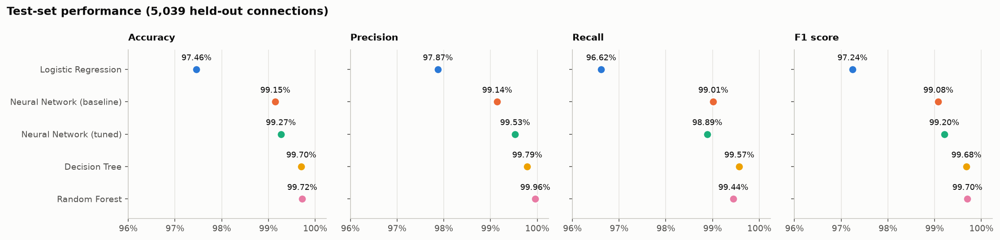

**Key findings**

- **The random forest is the best model overall.** It flagged only **1 of 2,705**
  normal connections as an attack (99.96% precision) and caught 99.44% of attacks.
- **The decision tree has the best recall.** It missed only 10 of 2,334 attacks,
  using 68 human-readable rules (depth 10). In intrusion detection a missed
  attack usually costs more than a false alarm.
- **Tree models beat the neural network on this data.** Many attacks are
  separated by sharp thresholds on single features, such as `src_bytes`, `count`
  and connection `flag`. Axis-aligned tree splits capture these directly.
- **Tuning helped the neural network a little.** Accuracy rose from 99.15% to
  99.27%, and false alarms fell from 20 to 11, at the cost of 3 more missed
  attacks (23 → 26).
- **Logistic regression trails at 97.46%.** A single linear boundary cannot
  capture the non-linear attack patterns that the other four models learn.

<p align="center">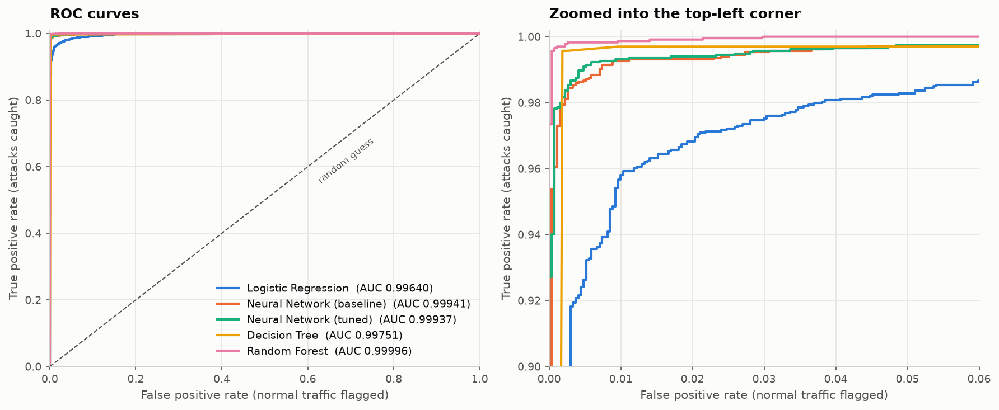</p>

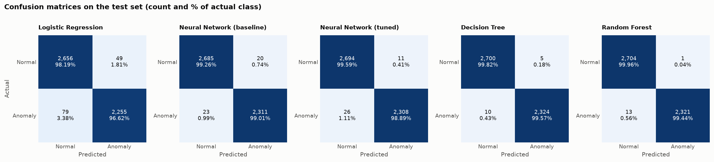

---

## Repository layout

```
.
├── data/
│   ├── Train_data.csv          # 25,192 labelled connections (used for training + testing)
│   ├── Test_data.csv           # 22,544 unlabelled connections (scored by predict.py)
│   └── README.md               # feature dictionary
├── notebooks/
│   └── original_colab_notebook.ipynb   # the notebook behind the presentation
├── src/
│   ├── config.py               # paths, seeds, hyperparameter grids
│   ├── data.py                 # loading, train/test split, one-hot + scaling
│   ├── models.py               # sklearn pipelines + PyTorch IntrusionNet
│   ├── evaluate.py             # metrics, Youden's J threshold
│   └── plots.py                # every figure
├── eda.py                      # exploratory plots + PCA check
├── train.py                    # tune, train and evaluate all models
├── predict.py                  # label new traffic with a saved model
├── models/                     # pre-trained models (re-created by train.py)
├── results/
│   ├── metrics.csv / metrics.md
│   ├── best_params.json
│   ├── nn_grid_search.csv
│   └── figures/
└── requirements.txt
```

## Quick start

```bash
git clone https://github.com/Adityasingh194/TCP-IP-Intrusion-Detection-ML.git
cd TCP-IP-Intrusion-Detection-ML
pip install -r requirements.txt

python eda.py        # exploratory figures -> results/figures/
python train.py      # tune + train + evaluate all models (a few minutes on a laptop CPU)
python predict.py    # label data/Test_data.csv -> results/test_predictions.csv
```

The trained models are included in `models/`, so `predict.py` works right after
cloning. Rerunning `train.py` reproduces the same models and numbers, because
all seeds are fixed.

`predict.py` options:

```bash
python predict.py --model neural_network          # random_forest | decision_tree | logistic_regression | neural_network
python predict.py --input my_traffic.csv --output my_predictions.csv
```

Any CSV with the 41 feature columns works. If it also has a `class` column,
`predict.py` prints accuracy, precision, recall and F1 as well.

## Dataset

[Network Intrusion Detection on Kaggle](https://www.kaggle.com/datasets/sampadab17/network-intrusion-detection).
The data is a simulated US Air Force LAN that was hit with a range of attacks.
Each row is one connection with **41 features**: 3 categorical (`protocol_type`,
`service`, `flag`) and 38 numeric. The labelled training file is close to
balanced: 53.4% normal, 46.6% anomaly. See [data/README.md](data/README.md) for
the full feature dictionary.

<p align="center">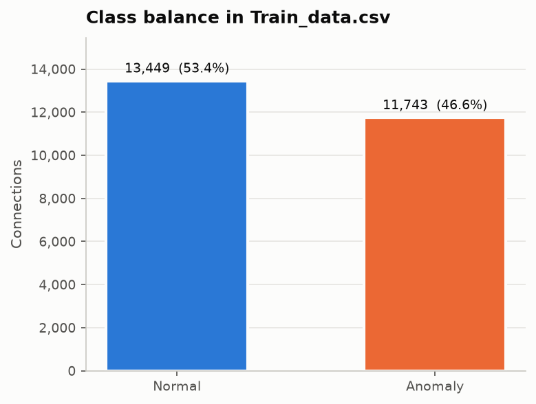</p>

## Method

### 1. Preprocessing

| Step | Detail |
|---|---|
| Target | `normal` → 0, `anomaly` → 1 |
| Split | 80/20 train/test, `random_state=12`. This is the same 5,039-row test set as the notebook |
| One-hot encoding | `protocol_type` (3), `service` (66), `flag` (11) → 80 binary columns, **118 features** in total |
| Scaling | `StandardScaler` for logistic regression and the neural network. Trees use raw values |
| PCA | explored, then **not used** (see below) |

All preprocessing lives inside scikit-learn pipelines that are fitted on training
data only. This means the saved models can score raw CSV rows directly.

**Why PCA was dropped.** The first 10 principal components keep only 31% of the
variance, and 77 of the 118 components are needed to reach 90%. The variance is
spread too evenly for PCA to compress the data without losing signal.

<p align="center">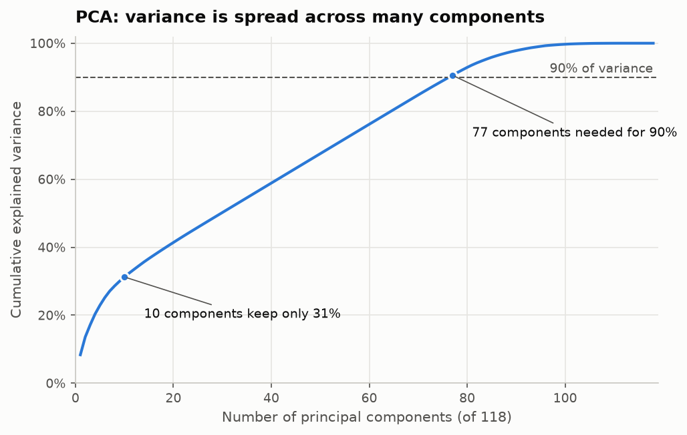</p>

### 2. Models

| Model | Architecture | How it was tuned |
|---|---|---|
| Logistic Regression | σ(wᵀx + b) | 5-fold `GridSearchCV` over `C` |
| Neural Network (baseline) | 118 → 20 → 10 → 1, ReLU, sigmoid output, BCE loss, Adam (lr 0.001, batch 64) | untuned "before tuning" configuration, threshold 0.5 |
| Neural Network (tuned) | 118 → h1 → h2 → 1, same layers | grid search over lr {0.01, 0.001} × h1 {20, 50} × h2 {10, 25} × batch {32, 64} on a validation split, then **threshold tuning** with Youden's J |
| **Decision Tree** *(new)* | CART | 5-fold `GridSearchCV` over criterion, max depth and min samples per leaf |
| **Random Forest** *(new)* | bagged ensemble of CART trees | 5-fold `GridSearchCV` over number of trees, max depth and min samples per leaf |

Every neural network is trained for 10 epochs. All grid searches score on F1 for
the anomaly class. Every model is evaluated on the same held-out test set, which
is never used for any tuning decision.

### 3. Threshold tuning

The neural network outputs P(anomaly). Instead of a fixed 0.5 cut-off, the
threshold is the point on the validation ROC curve that maximises
**TPR − FPR** (Youden's J).

<p align="center">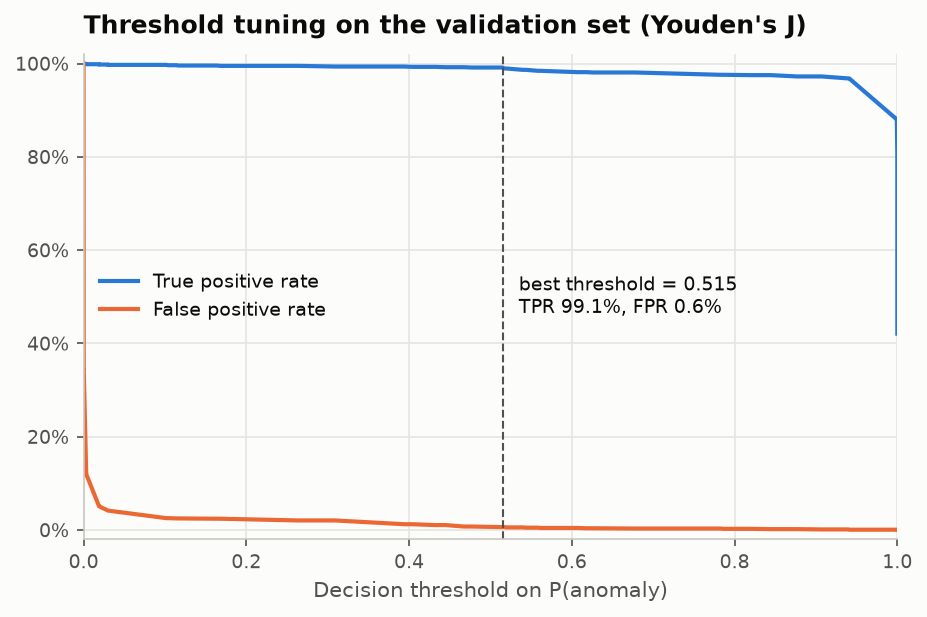</p>

The search selected **lr 0.001, hidden layers 20 → 10, batch size 32**, with a
decision threshold of **0.515**. All chosen hyperparameters are saved in
[results/best_params.json](results/best_params.json), and every grid-search run is in
[results/nn_grid_search.csv](results/nn_grid_search.csv).

## What the models learned

| Random forest feature importance | Neural network learning curve |
|---|---|
| 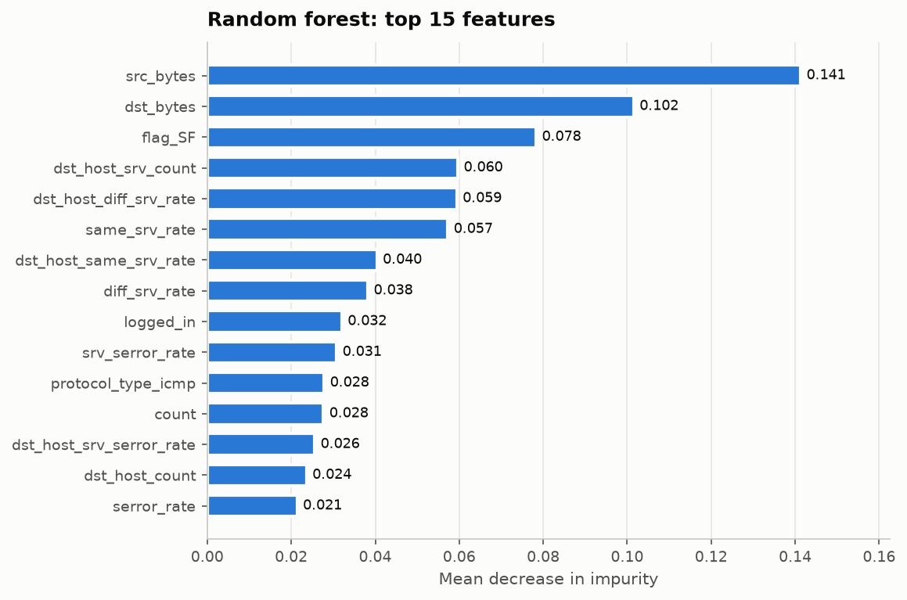 | 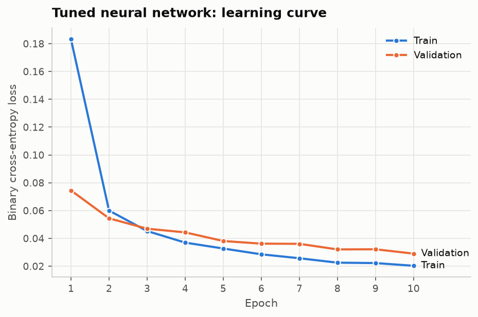 |

The tree's first split is `src_bytes <= 28.5`. Connections that send almost no
data are mostly attacks (92%), especially when `count` (connections to the same
host in the last 2 seconds) is high. These are the patterns of SYN floods and
port scans. The top three levels of the tuned decision tree:

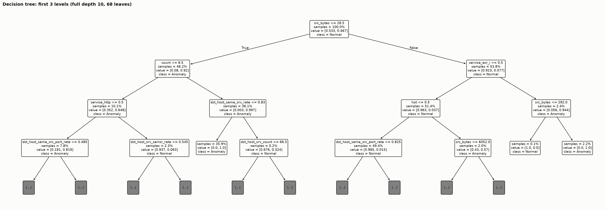

| Feature correlation | First two principal components |
|---|---|
| 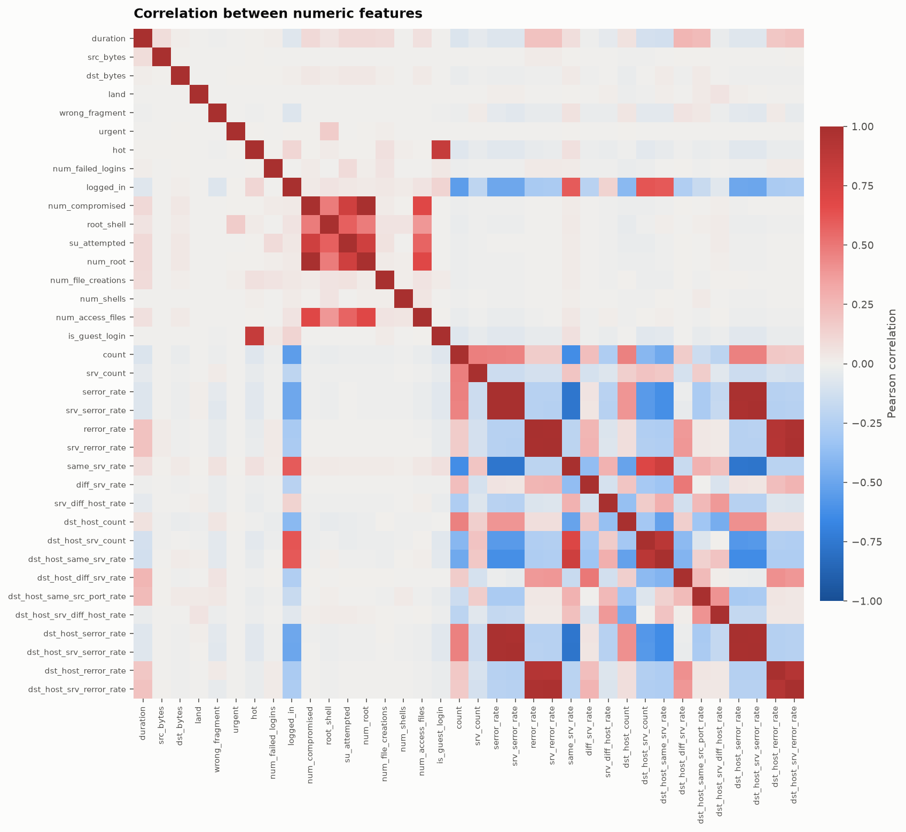 | 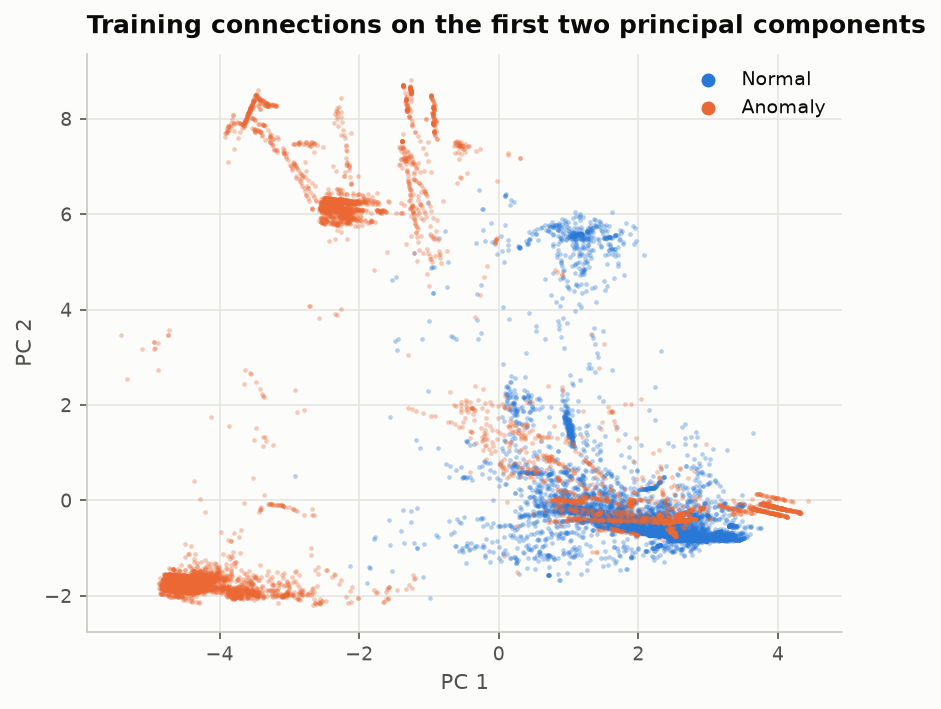 |

## Limitations

- **Known attacks vs. new attacks.** The test set above is a random 20% of
  `Train_data.csv`, so it contains the same kinds of attacks the models trained
  on. `Test_data.csv` appears to be the NSL-KDD `KDDTest+` file with its labels
  removed: it has the same 22,544 rows, and its first row matches. That file is
  documented as about 57% attacks and includes attack types that never appear in
  training. On it, the random forest flags 35.8% of connections and the tuned
  network flags 41.4%. This suggests a large share of new attacks would be
  missed. The 99%+ scores hold for attacks like those seen in training. They are
  not a guarantee for new attacks.
- **Simulated, older traffic.** The data is a simulation in the KDD '99 format,
  not modern encrypted traffic.
- **Binary labels only.** The models say *whether* a connection is an attack,
  not which type (DoS, probe, R2L, U2R).

## Changes from the original notebook

The [original Colab notebook](notebooks/original_colab_notebook.ipynb) is included
unchanged. The scripts here build on it in four ways:

1. **No tuning on the test set.** The notebook chose the network's
   hyperparameters and decision threshold by looking at test-set accuracy. Here,
   both are chosen on a validation split carved out of the training data, and
   the scikit-learn models use 5-fold cross-validation. This makes the reported
   test scores an honest estimate of performance on new traffic.
2. **Logistic regression uses all 118 features.** In the notebook it was trained
   on 10 PCA components.
3. **Two new models**: a decision tree and a random forest.
4. **Reusable models.** Preprocessing and model are saved together, and
   `predict.py` can label `Test_data.csv` or any new traffic.

## Conclusion

Military networks are prime targets, and static rules cannot keep up with
stealthy, evolving attacks. A learned detector moves security from reactive
patching toward proactive defence. The same pipeline applies to other critical
networks, such as power grids, banks and hospitals.

## Links

- Dataset: <https://www.kaggle.com/datasets/sampadab17/network-intrusion-detection>
- Original Colab notebook: <https://colab.research.google.com/drive/16d_vbC5R4-PEPDZLl6fdbAn80bDaMbS4?usp=sharing>
